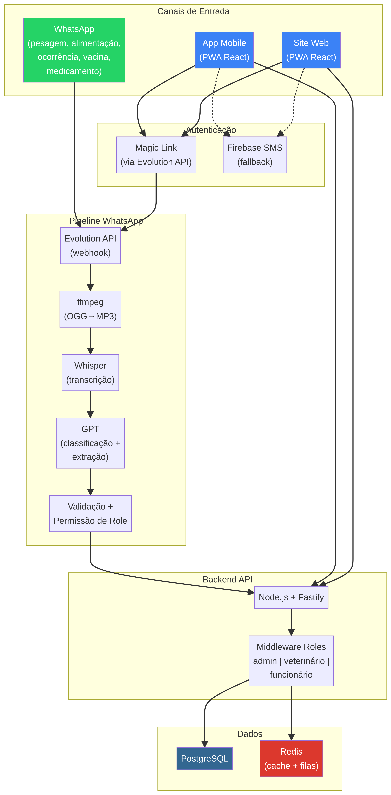

# ManejoPrime

Cattle herd management for Brazilian farms. Field workers log daily operations (weighings, vaccines, medications, feeding, occurrences) by sending WhatsApp messages, including voice notes. Managers use a web admin panel to run the farm.



## Stack

| Area | Technologies |
|---|---|
| Backend API | Java 21, Spring Boot 3.4, Spring Data JPA, Flyway, PostgreSQL (H2 for the local profile), ArchUnit |
| Async processing | Kafka (Spring Kafka) worker for WhatsApp audio download, transcoding and transcription (OpenAI) |
| Messaging | WhatsApp via Evolution API |
| Admin web | React 19, TypeScript, Vite, TanStack Query, Tailwind CSS 4, Storybook, Vitest |
| End-to-end tests | Playwright (API, WhatsApp and UI suites) |
| Infra | Docker, Docker Compose, Redis, GitHub Actions CI |

The backend is a modular monolith. Each domain lives in its own package under `apps/backend/src/main/java/br/com/curralzap/backend/`: `animals`, `lots`, `weighings`, `vaccines`, `medications`, `feeding`, `occurrences`, `offers`, `reports`, `farms`, `users`, `auth`, `billing`, `notifications`, `whatsapp`. ArchUnit tests enforce the module boundaries.

## Repository layout

```
apps/
  backend/          Spring Boot API (also builds the worker image)
  backend-worker/   Worker deployment config (same Dockerfile, worker target)
  admin-web/        React admin panel
  e2e/              Playwright end-to-end tests
infra/              Docker, Compose files and env templates
docs/reference/     Architecture and ER diagrams
```

## Running locally

Requirements: Java 21, Maven 3.9+, Node.js 20, Docker with Compose v2.

**Backend only (fastest loop).** This uses the `local` profile: an H2 database pre-loaded with a demo farm.

```bash
cd apps/backend
mvn -Dspring-boot.run.profiles=local spring-boot:run
# API on http://127.0.0.1:8080, H2 console on /h2-console
```

**Full stack with Docker Compose.** This runs PostgreSQL, Redis, Kafka, Kafka UI, Evolution API, the backend API and the worker. Add `--profile web` to also run the admin web container.

```bash
docker compose \
  --env-file infra/env/local-compose.env.example \
  -f infra/compose/local.yml \
  up -d
```

**Admin web dev server:**

```bash
npm install
npm run dev --workspace @curralzap/admin-web
# http://localhost:5173
```

## Tests

```bash
cd apps/backend && mvn test        # backend unit + integration tests
npm run test:admin-web             # admin web (Vitest)
cd apps/e2e && npm test            # end-to-end (Playwright)
```

## License

Proprietary. The source is published for portfolio and reference purposes only. See [LICENSE](LICENSE).
